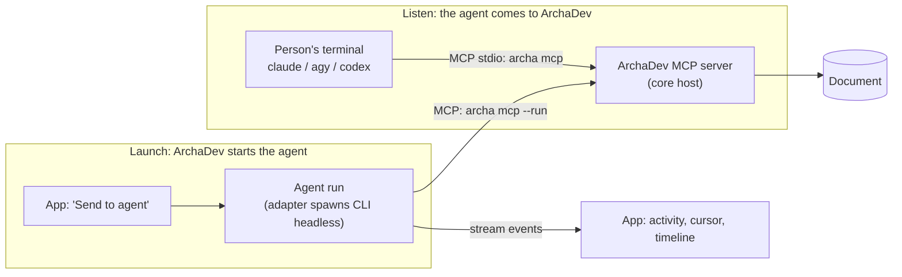

# Agents and MCP

← [Plan INDEX](./INDEX.md)

| Part | Coverage |
|---|---|
| [01 — MCP server](./AGENTS_AND_MCP/01-mcp-server.md) | Transports, tool surface, `execute` API, response contract, lint |
| [02 — Agent bridge](./AGENTS_AND_MCP/02-agent-bridge.md) | Adapters for Claude Code / agy / Codex / Hermes, profiles, runs, steering, worktrees (Gungnir flow) |
| [03 — Local skill](./AGENTS_AND_MCP/03-local-skill.md) | The skill file, references, install per agent |
| [04 — Review loop](./AGENTS_AND_MCP/04-review-loop.md) | Comments, rounds, decisions, variants, activity (Accent flow) |

## Two directions, one server

The same MCP tools serve both. In launch mode the app also reads the agent's own output stream (Gungnir parsers) to show a live timeline and to steer it.
