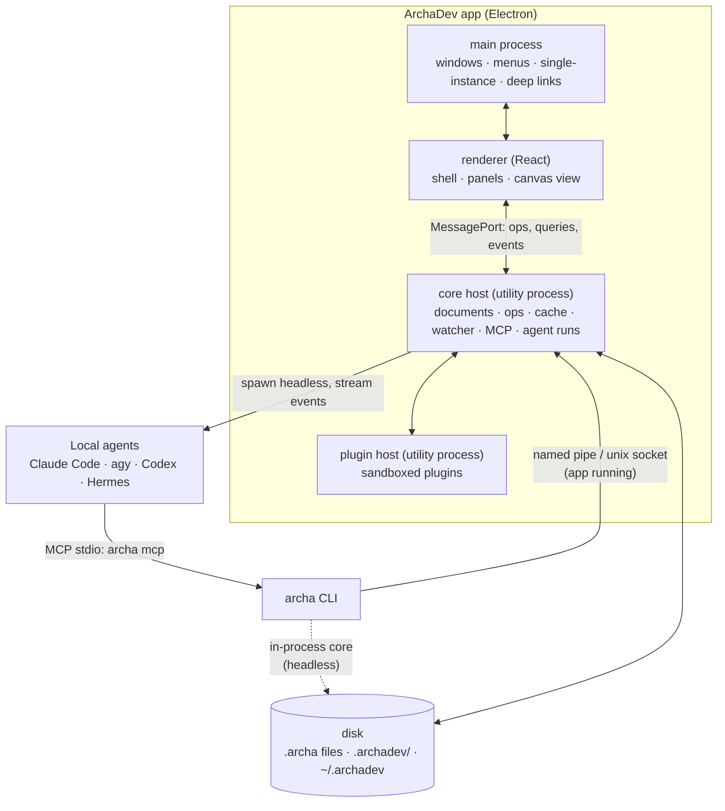

# Architecture

← [Plan INDEX](./INDEX.md)

| Part | Coverage |
|---|---|
| [01 — Process model](./ARCHITECTURE/01-process-model.md) | Electron main, core host, renderer, headless CLI, IPC, single writer |
| [02 — Document model](./ARCHITECTURE/02-document-model.md) | Nodes, properties, ops, transactions, undo, revisions, auto-layout |
| [03 — Cache system](./ARCHITECTURE/03-cache-system.md) | Hashing, in-memory indexes, render tiles, disk asset store, budgets |
| [04 — Rendering and layers](./ARCHITECTURE/04-rendering-and-layers.md) | Canvas engine, render layers, the layer tree, code frames |
| [05 — Monorepo and stack](./ARCHITECTURE/05-monorepo-stack.md) | Packages, libraries, build, test |

## Overview

The core host owns every document. The renderer, the CLI and the MCP server are clients. When the app is not running, the CLI loads the same core in-process (headless) — so `archa export` or an agent session work without a window.
